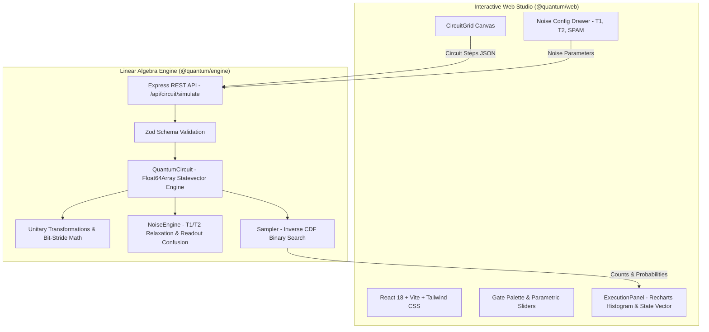

# Q-Sim: Full-Stack Classical Quantum Circuit Simulator & Playground

[](https://www.typescriptlang.org/)
[](https://reactjs.org/)
[](https://vitejs.dev/)
[](https://expressjs.com/)
[](#test-suite)
[](LICENSE)

An end-to-end, production-grade Web Application that mathematically simulates quantum circuit execution on classical hardware. Built with a decoupled **Node.js/TypeScript statevector engine** and an interactive **React (Vite) IBM Quantum Composer-style visual canvas**.

---

## 📑 Documentation & Manuals
- **[Interactive HTML Manual](manual.html)**
- **[PDF Instruction Manual](Q-Sim_Instruction_Manual.pdf)**

---

## 🌟 Key Features

### 1. High-Performance Classical Simulation Core (`@quantum/engine`)
- **State-Vector Formalism**: Contiguous `Float64Array` buffers for real and imaginary amplitudes $\mathcal{O}(2^n)$, supporting up to 16 qubits.
- **Bit-Stride Matrix Transformation**: Executes single-qubit transformations in-place using bitwise index manipulation, avoiding $\mathcal{O}(2^{2n})$ Kronecker matrix allocations.
- **Physical Hardware Noise (Decoherence)**:
  - **$T_1$ Thermal Relaxation**: Models spontaneous $|1\rangle \to |0\rangle$ energy decay ($\gamma = 1 - e^{-t_g / T_1}$).
  - **$T_2$ Pure Dephasing**: Loss of quantum phase coherence ($\lambda = 1 - e^{-t_g / T_\phi}$).
  - **Depolarizing Noise Channel**: Injects random Pauli $\{X, Y, Z\}$ errors with configurable rates.
  - **Readout Errors (SPAM)**: Classical confusion matrix $P(\text{measured} \mid \text{actual})$ reflecting physical detector imperfections.
- **Monte Carlo Projective Measurement**: Fast binary search cumulative distribution function (CDF) sampling.

### 2. Interactive Quantum Playground (`@quantum/web`)
- **IBM Quantum Composer-Style Grid**: Multi-wire canvas ($q_0 \dots q_{n-1}$) with discrete temporal columns and SVG multi-qubit entangling lines.
- **Gate Palette**: Full spectrum of quantum gates:
  - *Superposition & Clifford*: $H, X, Y, Z, S, T, I$
  - *Parametric Rotations*: $R_x(\theta), R_y(\theta), R_z(\lambda), U(\theta, \phi, \lambda)$ with continuous angle sliders.
  - *Entangling & Multi-Qubit*: $\text{CX}$ (CNOT), $\text{CZ}$, $\text{SWAP}$, $\text{CCX}$ (Toffoli).
  - *Operations*: Computational Measurement ($M$) and Barriers ($│$).
- **Live Telemetry & Diagnostics**:
  - Measurement outcome distribution histogram powered by Recharts.
  - State-vector table displaying exact complex amplitude $(a + bi)$, magnitude, and polar phase angle ($\theta$).
- **Physical Noise Configuration Drawer**: Real-time sliders for $T_1$, $T_2$, gate times, and readout error rates.

---

## 🏛️ System Architecture



---

## 🚀 Quick Start

### 1. Installation
Clone the repository and install all dependencies:
```bash
git clone https://github.com/Niroop-H/Devashri_S_Quantum.git
cd Devashri_S_Quantum
npm install
```

### 2. Run the Development Servers
Start both the backend simulation engine and the web studio:

```bash
# Terminal 1: Backend Simulator (Port 4000)
npm run dev:engine

# Terminal 2: Frontend Web Studio (Port 3000)
npm run dev:web
```

Visit **`http://localhost:3000`** in your browser.

### 3. Run Automated Mathematical Tests
```bash
npm test
```

---

## 🧪 Test Suite Verification

The engine includes 10 automated mathematical verification suites:

| Test Case | Quantum Circuit | Theoretical Expectation | Measured Result | Status |
| :--- | :--- | :--- | :--- | :---: |
| **Ground State** | Initial state | $P(\|00\dots0\rangle) = 1.0$ | $1.000000$ | **PASS** |
| **Pauli-X Gate** | $X(0) \|0\rangle$ | $P(\|1\rangle) = 1.0$ | $1.000000$ | **PASS** |
| **Hadamard Gate** | $H(0) \|0\rangle$ | $P(\|0\rangle) = 0.5, P(\|1\rangle) = 0.5$ | $0.500000, 0.500000$ | **PASS** |
| **Bell State** | $[H(0), CX(0 \to 1)]$ | $\sim 50\% \|00\rangle, \sim 50\% \|11\rangle$ (4096 shots) | $49.8\% \|00\rangle, 50.2\% \|11\rangle$ | **PASS** |
| **GHZ State** | $[H(0), CX(0 \to 1), CX(1 \to 2)]$ | $\sim 50\% \|000\rangle, \sim 50\% \|111\rangle$ (4096 shots) | $50.4\% \|000\rangle, 49.6\% \|111\rangle$ | **PASS** |
| **Toffoli Gate** | $CCX(0, 1 \to 2)$ on $\|110\rangle$ | Flips to $\|111\rangle$ ($P = 1.0$) | $\|111\rangle$ with $P = 1.0$ | **PASS** |
| **SWAP Gate** | $SWAP(0, 1)$ on $\|01\rangle$ | Exchanges to $\|10\rangle$ ($P = 1.0$) | $\|10\rangle$ with $P = 1.0$ | **PASS** |
| **Parametric Rx** | $R_x(\pi) \|0\rangle$ | Bit flip to $\|1\rangle$ | $P(\|1\rangle) = 1.000000$ | **PASS** |
| **SPAM Noise** | 10% flip error on $\|000\rangle$ | $1 - (0.9)^3 \approx 27.1\%$ bit flips | $\approx 26.8\%$ flips | **PASS** |
| **CDF Sampler** | Uniform superposition | 10,000 shots sum & normalization | Exact shot conservation | **PASS** |

---

## 📡 REST API Reference

### Health Check
```http
GET /health
```
```json
{
  "status": "healthy",
  "engine": "Q-Sim Classical Statevector Engine v1.0",
  "maxQubits": 16
}
```

### Circuit Execution
```http
POST /api/circuit/simulate
Content-Type: application/json
```
```json
{
  "qubits": 2,
  "shots": 2048,
  "steps": [
    { "id": "1", "gate": "H", "targets": [0] },
    { "id": "2", "gate": "CX", "targets": [1], "controls": [0] }
  ],
  "noiseModel": {
    "enabled": false,
    "t1": 50.0,
    "t2": 70.0,
    "gateTime": 0.02,
    "readoutError": [0.015, 0.025],
    "depolarizingRate": 0.001
  }
}
```

---

## 📂 Repository File Tree

```text
quantum-simulator/
├── package.json                   # Root monorepo workspace configuration
├── tsconfig.json                  # Root TypeScript configuration
├── .gitignore                     # Git exclusions
├── manual.html                    # Interactive instruction manual
├── Q-Sim_Instruction_Manual.pdf   # Publication-grade PDF manual
├── apps/
│   ├── engine/                    # Node.js Classical Simulation Engine
│   │   ├── package.json
│   │   ├── tsconfig.json
│   │   └── src/
│   │       ├── types/circuit.ts   # Zod validation schemas & types
│   │       ├── math/complex.ts    # Complex matrix helpers
│   │       ├── math/gates.ts      # Unitary gate definitions
│   │       ├── simulator/
│   │       │   ├── QuantumCircuit.ts # Statevector engine with bit-stride math
│   │       │   ├── NoiseEngine.ts    # T1/T2 decoherence & SPAM models
│   │       │   └── Sampler.ts        # Inverse CDF binary search
│   │       ├── test/verify.test.ts   # Mathematical test suites (10/10 PASS)
│   │       └── server.ts          # Express REST API
│   └── web/                       # React 18 / Vite Interactive Studio
│       ├── package.json
│       ├── vite.config.ts
│       ├── tailwind.config.js
│       ├── index.html
│       └── src/
│           ├── App.tsx            # Main playground state & layout
│           ├── components/
│           │   ├── Header.tsx         # Backend state & controls
│           │   ├── Palette.tsx        # Gate palette & parametric sliders
│           │   ├── CircuitGrid.tsx    # Quantum wire canvas
│           │   ├── ExecutionPanel.tsx # Status bar & tabbed telemetry
│           │   ├── HistogramView.tsx  # Recharts measurement histogram
│           │   └── StateVectorView.tsx# Complex amplitude table
│           └── services/api.ts        # REST client
```

---

## 📜 License
MIT License. Created for Classical Quantum Simulation and Quantum Information Research.
